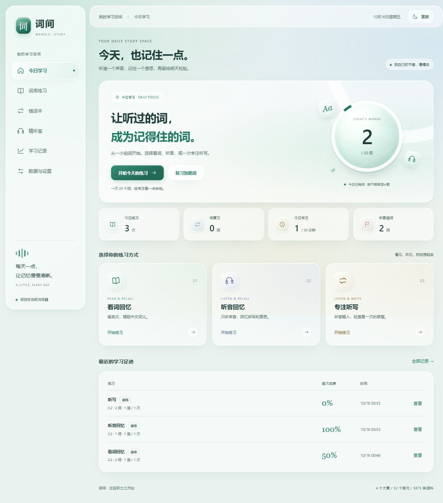
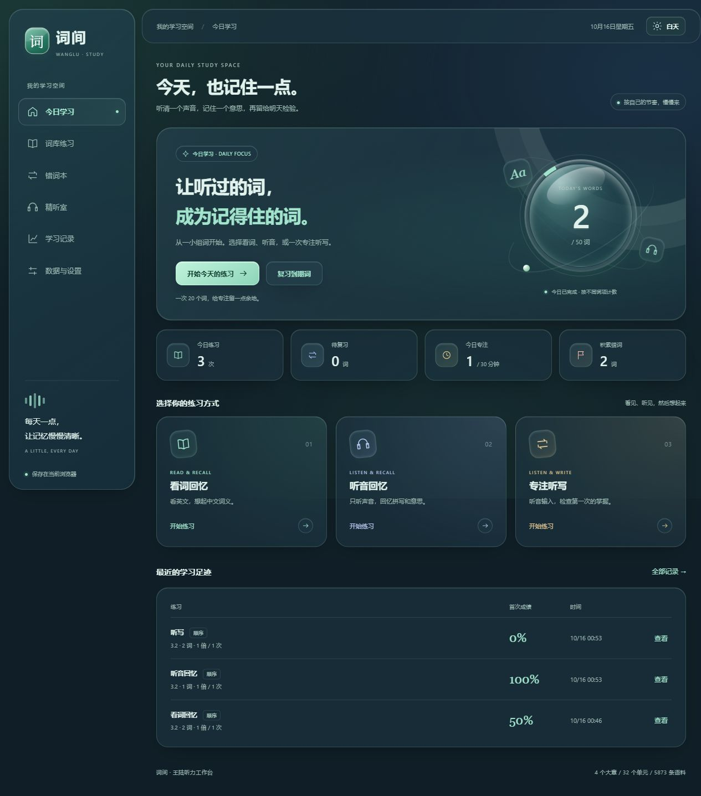

# 词间 · 王陆听力工作台

看英文，回忆中文词义；听英文，回忆单词和意思。一个面向个人雅思备考的浏览器学习工具，将背词、听写、错词复习与原录音精听放在同一个工作台里。

**[在线使用](https://universeca.github.io/wanglu-dictation-app/) · [使用说明](docs/使用与验收.md) · [反馈问题](https://github.com/UniverseCA/wanglu-dictation-app/issues) · [来源与版权](NOTICE.md)**

无需注册，免费访问。源码公开可查看、下载，授权范围见文末。学习记录保存在当前浏览器，没有账号和云端同步。





截图中的记录为开发验收样例，网站不预置个人学习历史。

## 主要功能

| 学习方式 | 功能 |
| --- | --- |
| 看词回忆 | 显示英文，先回忆中文，再揭晓并标记认识、模糊或不会 |
| 听音回忆 | 隐藏单词和释义，听音回忆拼写与意思；支持输入拼写自测 |
| 听写练习 | 顺序或乱序，按章节、位置范围和词量组题；首次成绩与订正分开保留 |
| 连续播放 | 音频继续播放，输入光标留在原来的位置；支持暂停、继续、切词和重播 |
| 错词复习 | 从全部词、错词、当前模式到期词中选择；保留原始错拼、来源与错因 |
| 个人词表 | 批量粘贴词汇，独立组题练习 |
| 原录音精听 | 本地录音、A–B 片段循环、变速播放，保存听写与参考文本 |
| 听力专项 | 数字、日期、姓名、地址、词尾、短语、句子填空、同义替换 8 类自编练习 |
| 学习进度 | 每日目标、到期复习、历史详情，以及相同题集和设置下的成绩趋势 |
| 日夜主题 | 青绿 / 深海液态玻璃、立体进度球、跟随系统；适配手机与桌面 |

继承词库包含 **4 个大章、32 个练习单元、5873 条记录**，包含章节间重复词；原文与来源保留。专项为自编辅助练习，不是官方雅思试题；工具成绩不换算雅思分数。

## 开始使用

1. 打开 **[正式网站](https://universeca.github.io/wanglu-dictation-app/)**，选择看词、听音或听写模式。
2. 选择全部词、错词或到期词，设置章节、顺序和词量。
3. 完成练习、查看结果并订正，再通过错词和到期复习巩固。
4. 定期到 **「数据与设置 → 导出完整备份」**，将 JSON 文件保存到浏览器之外。

建议使用 Chrome 或 Edge，并固定使用同一个网站地址。发音优先使用浏览器英语语音；词典和在线合成语音需要网络。离线朗读取决于本机语音包和浏览器支持，不保证完全离线使用。

也可下载 `index.html` 或 `王陆语料库听写练习_v5.html`，两份文件功能一致。直接双击时的存储和音频行为可能因浏览器而异；推荐使用正式网站或下文的本地 HTTP 预览。

### 快捷键

| 场景 | 按键 |
| --- | --- |
| 听写下一行 | `Enter` |
| 播放当前输入行 | `F2` |
| 批改听写 | `Ctrl/⌘ + Enter` |
| 背词揭晓 | `空格` |
| 背词标记 | `1` 认识、`2` 模糊、`3` 不会 |
| 关闭详情并暂停听写队列 | `Escape` |

背词快捷键不会拦截输入框里的正常输入。

## 数据与备份

**记录保存在本机浏览器，网站发布不等于云端备份。**

- 历史、错词、个人词表、草稿与设置保存在 `localStorage`；本地录音尝试缓存到 `IndexedDB`。
- 不同浏览器、设备或站点来源（协议、域名、端口）不共享记录。由本地预览转到正式网站，先在旧地址导出，再到新地址导入。
- 只清理“缓存的图片和文件”通常不影响记录；删除“Cookie 及其他网站数据”、重置浏览器或浏览器清理站点存储会丢失数据。清理前先备份。
- JSON 备份包括文字记录、词表、草稿、设置和录音片段标记，**不包含录音文件**。请保留原始录音，缓存不可用时重新选择原文件。
- 导入支持预览、合并和替换，导入前保留本地安全快照；快照同属浏览器存储，不能替代外部备份。
- 支持迁移旧版 `wl3_hist / wl3_wb` 与 `wl2` 历史和错词，迁移不删除旧键值。其他浏览器的旧记录可在设置中按旧版格式导入。

本应用不提供学习记录或录音上传功能。网站托管服务仍会处理访问请求；联网发音时会向外部服务发送当前词条。当前使用浏览器 Speech Synthesis、有道发音、Google 在线合成语音，以及 [Free Dictionary API](https://dictionaryapi.dev/) 查询的词典音频；这不表示存在合作或官方授权。

## 成绩与复习

- 首次结果与订正分别保留；完成时保存练习，重复完成不重复计数。
- 看词、听音、听写分别记录掌握情况和复习进度。
- 初始复习间隔为 1、3、7、14、30、60 天；同一天反复答对不累计为跨日掌握，跨日连续 3 次首次回忆正确标为已掌握。这是初始规则，不是个体最佳间隔的测量结果。
- 播放失败停在当前词，可重试或明确跳过；未播放项不进入成绩分母或错误次数。
- 保存失败或多个页面产生写入冲突时会提示，避免把未保存状态当成成功。

## 本地开发

需要 **Node.js 22 或更新版本**。

```sh
git clone https://github.com/UniverseCA/wanglu-dictation-app.git
cd wanglu-dictation-app
npm ci
npm run dev
```

打开 `http://127.0.0.1:4173/`。修改源码后重新构建并刷新；开发服务器只监听本机，不提供热更新。

```sh
npm test          # 领域逻辑与 DOM 交互回归检查
npm run build    # 生成两份一致的独立 HTML
npm run check    # 测试、构建、产物一致性与脚本语法检查
```

| 路径 | 内容 |
| --- | --- |
| `data/vocab.json` | 继承的原始词库 |
| `src/core/` | 词条、批改、会话、复习、存储与迁移 |
| `src/audio.js` | 发音来源与可取消的播放队列 |
| `src/features/` | 回忆、错词、精听与专项 |
| `src/app.js` / `src/styles.css` | 应用交互与主题布局 |
| `scripts/` / `tests/` | 构建工具与回归检查 |
| `review/` | 历史架构审查与旧版复现资料 |

提交源码时同时提交两份生成的 HTML。GitHub Actions 检查构建一致性；`main` 分支通过部署检查后自动发布到 GitHub Pages，仅发布独立 HTML。

欢迎提交 Issue 或范围明确的 Pull Request。请说明复现步骤、预期行为和浏览器版本，不要提交个人学习备份、录音或敏感信息。

## 致谢与资料来源

本项目沿用前人公开项目的词库与听写工具基础，再重构学习流程、模块结构与界面：

| 来源 | 致谢与关系 |
| --- | --- |
| [zyxlele/wanglu-dictation](https://github.com/zyxlele/wanglu-dictation) | 原始听写工具，提供本项目的上游基础 |
| [PipiTang233/wanglu-dictation-app](https://github.com/PipiTang233/wanglu-dictation-app) | 上游衍生版本，加入内置发音与乱序练习，本次重构以该版本演进而来 |
| 王陆老师及相关出版方 | 继承词库所标注的语料来源，资料权利归相应权利人所有 |
| [esbuild](https://github.com/evanw/esbuild) / [Happy DOM](https://github.com/capricorn86/happy-dom) | 分别用于构建与 DOM 测试，适用各自许可证 |

本仓库由 [UniverseCA](https://github.com/UniverseCA) 维护。当前版本新增双模式回忆、独立播放队列、错词与复习管理、精听、备份迁移和日夜主题。上游作者的贡献与资料权利不因重构而改变。

本工具不是王陆老师、相关出版方或雅思考试机构的官方产品，也未声明获得其认可。完整来源说明见 [NOTICE.md](NOTICE.md)。

## 如何引用

引用当前软件时，请注明项目名、维护者、仓库链接及实际使用的提交或版本。GitHub 的 **Cite this repository** 可读取 [CITATION.cff](CITATION.cff)。例如：

> UniverseCA. 词间 · 王陆听力工作台 [计算机软件]. https://github.com/UniverseCA/wanglu-dictation-app （请补充实际使用的提交与访问日期）.

讨论项目起源时，请同时引用上述两个上游仓库。引用词汇或教材内容时，请另行引用实际使用的原书；本仓库未核实教材版次、ISBN 或页码，不能替代原始出版物引用。

## 公开获取与授权边界

网站可免费访问，仓库公开可查看、下载。**公开访问不等于所有代码和语料均已获得自由再许可。**

截至 2026-10-16 核对时，两个上游仓库均未发现明确的软件开源许可证。本仓库保留上游署名及个人学习、非商用用途说明，暂不对整个项目声明 MIT 等统一开源许可，也不替第三方授予修改、再分发或商业使用权。第三方依赖适用原许可证；词库与导入录音适用各自权利条件。引用和致谢不能替代授权。

如需将整个衍生项目按标准开源许可证再发布，应先明确上游代码与语料授权。权利人可通过 [Issue](https://github.com/UniverseCA/wanglu-dictation-app/issues) 联系维护者。
